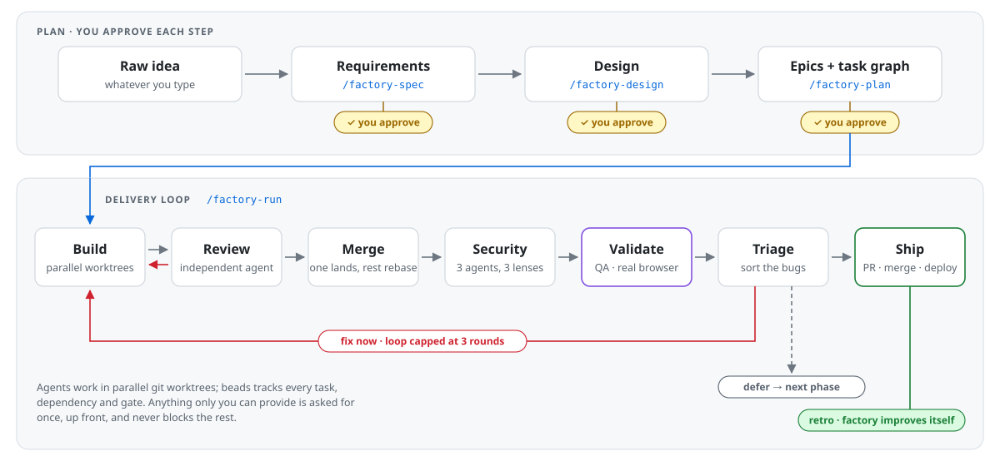

# Koujou 工場

**A software factory for Claude Code. Hand it an idea; a swarm of agents takes it to shipped, tested, validated software.**

**Platforms:** macOS, Linux

[](LICENSE)
[](https://github.com/rummykhan/koujou/stargazers)
[](https://github.com/rummykhan/koujou/commits/main)
[](https://claude.com/claude-code)
[](https://github.com/gastownhall/beads)
[](https://playwright.dev)
[](https://github.com/rummykhan/koujou/pulls)

*Koujou* (工場, kōjō) is Japanese for "factory". It turns a raw request into requirements, a design and a dependency graph of tasks, then runs an orchestrated swarm of builder, reviewer and QA agents in parallel git worktrees until the work is validated. You approve at the gates; the factory does the rest, and improves itself after every run.

<picture>
  <source media="(prefers-color-scheme: dark)" srcset="docs/flow-dark.svg">
  
</picture>

## ⚡ Quick Start

```bash
# Install koujou (system-wide; also installs beads if you don't have it)
curl -fsSL https://raw.githubusercontent.com/rummykhan/koujou/main/install.sh | bash

# Wire up YOUR project
cd your-project
koujou init
```

Restart Claude Code, open it in your project, and run:

```text
/factory-setup
```

Then give it work:

```text
/factory add CSV export to the posts page
```

**Note:** Koujou is installed once and used everywhere. You don't clone this repository into your project.

`koujou init` is instant and commits nothing. It creates `.beads/` (the task database), `FACTORY.md` (the project profile), a factory block in `AGENTS.md` (how work gets done, plus the living system design), and makes `CLAUDE.md` import `AGENTS.md`. `/factory-setup` then reads your code, proves your test gate, and fills those files in.

## 🤖 Installing with an agent

Give your agent this repository and it can do the whole thing. The steps it should run:

```bash
curl -fsSL https://raw.githubusercontent.com/rummykhan/koujou/main/install.sh | bash
```

```bash
cd /path/to/your/project
koujou init
koujou doctor
```

Then restart Claude Code so the new skills and agent types load, and run `/factory-setup` in the project. Agents: don't commit the files `koujou init` creates unless asked; report which files changed.

Already installed? Update instead:

```bash
koujou update
```

## 🛠 Features

* **Idea to shipped:** requirements, system design, epics and tasks, build, review, QA, deploy, validation, bug triage.
* **Swarm in worktrees:** independent tasks are built at the same time, each agent in its own git worktree; the orchestrator merges one branch at a time.
* **Nobody grades their own work:** a separate reviewer checks every task against acceptance criteria written before the code.
* **QA department:** a test engineer writes the acceptance suite from the requirements (Playwright for UIs); a validator uses the running product in a real browser and saves evidence.
* **You are asked once:** API keys, access and decisions are requested up front, in one batch. What you can't provide is built against a fake and listed under "Waiting on you".
* **Loops are capped:** a task that keeps failing review, or an epic that keeps failing validation, stops and comes to you instead of burning tokens.
* **Living system design:** `AGENTS.md` holds an as-built description of your system, rewritten whenever an epic ships.
* **Self-improving:** every epic ends with a retro that edits the factory's own skills and worker instructions, logged in [`CHANGELOG.md`](CHANGELOG.md).
* **Fits your project:** `FACTORY.md` holds your commands, git and deploy policy; the skills stay generic.

## 📖 Commands

In your terminal:

| Command | Action |
| --- | --- |
| `koujou init` | Wire the current project: beads, `FACTORY.md`, `AGENTS.md`, `CLAUDE.md`. |
| `koujou doctor` | Check the installation and the current project. |
| `koujou update` | Pull the latest koujou and relink. |
| `koujou uninstall` | Remove the links. Beads and your projects are untouched. |

In Claude Code:

| Command | Action |
| --- | --- |
| `/factory-setup` | Onboard a project, existing or empty. Run once. |
| `/factory <request>` | Size the work and run the pipeline. |
| `/factory-spec` | Raw request → testable requirements. |
| `/factory-design` | Requirements → system design. |
| `/factory-plan` | Design → epics and a task graph in beads. |
| `/factory-run <epic-id>` | The delivery loop: build, review, merge, deploy, validate, triage. |
| `/factory-retro` | Learn from the run and improve the factory. |

## 🔄 How a run goes

**1. You describe what you want.** The factory writes requirements with acceptance criteria and lists everything it needs from you.

```text
/factory let users export their posts as CSV
```

**2. You approve the requirements, the design (for bigger work) and the plan.** The plan is a graph of tasks in beads:

```bash
bd swarm validate <epic-id>
```

```text
Wave 1: 3 issues   ← built in parallel
Wave 2: 1 issues
Max parallelism: 3
```

**3. The swarm builds.** Each ready task gets a worktree and a builder; a QA tester writes acceptance tests alongside. Reviewers pass or bounce each branch; passing branches are merged one at a time.

**4. QA validates.** The acceptance suite runs, then a validator uses the real product. Bugs are triaged: fix now (back into the loop) or defer to the next phase.

**5. You get a report.** What shipped, the evidence, what was deferred, and what is waiting on you.

See what's happening at any time:

```bash
bd epic status
```

```bash
bd list --label factory:needs-user --status open
```

## 🏭 The workers

| Worker | Job |
| --- | --- |
| **Orchestrator** | Your Claude Code session. Briefs agents, merges, records state in beads, talks to you. |
| `factory-builder` | Implements one task in its own worktree. |
| `factory-reviewer` | Independently checks a task against its acceptance criteria. Read-only. |
| `factory-tester` | QA. Writes the automated acceptance suite from the requirements. |
| `factory-validator` | QA. Exercises the running product like a user. |

Workers coordinate through a per-task mailbox (beads comments) and never touch each other's files. The rules are in [`skills/factory/reference/swarm.md`](skills/factory/reference/swarm.md).

## 📁 What's in this repo

| Path | What |
| --- | --- |
| [`skills/`](skills) | The pipeline stages, as Claude Code skills. |
| [`skills/factory/reference/`](skills/factory/reference) | Conventions: beads, swarm protocol, blockers, templates. |
| [`agents/`](agents) | The worker definitions. |
| [`bin/koujou`](bin/koujou) | The CLI. |
| [`CHANGELOG.md`](CHANGELOG.md) | What the factory changed about itself, and why. |
| [`lab/`](lab) | Notes from the test runs the factory was developed against. |

## ✅ Requirements

* [Claude Code](https://claude.com/claude-code)
* `git` and `bash`
* [beads](https://github.com/gastownhall/beads) (`bd`), installed for you by the installer

## 🧪 Status

Koujou is new. It has delivered two epics end to end in a lab project (an API, then a web UI with a Playwright suite). Not yet exercised: a deploy beyond a local process, and a full delivery on a large existing codebase. See [`lab/README.md`](lab/README.md) for exactly what has and has not been tested.

## 📝 License

[MIT](LICENSE)
